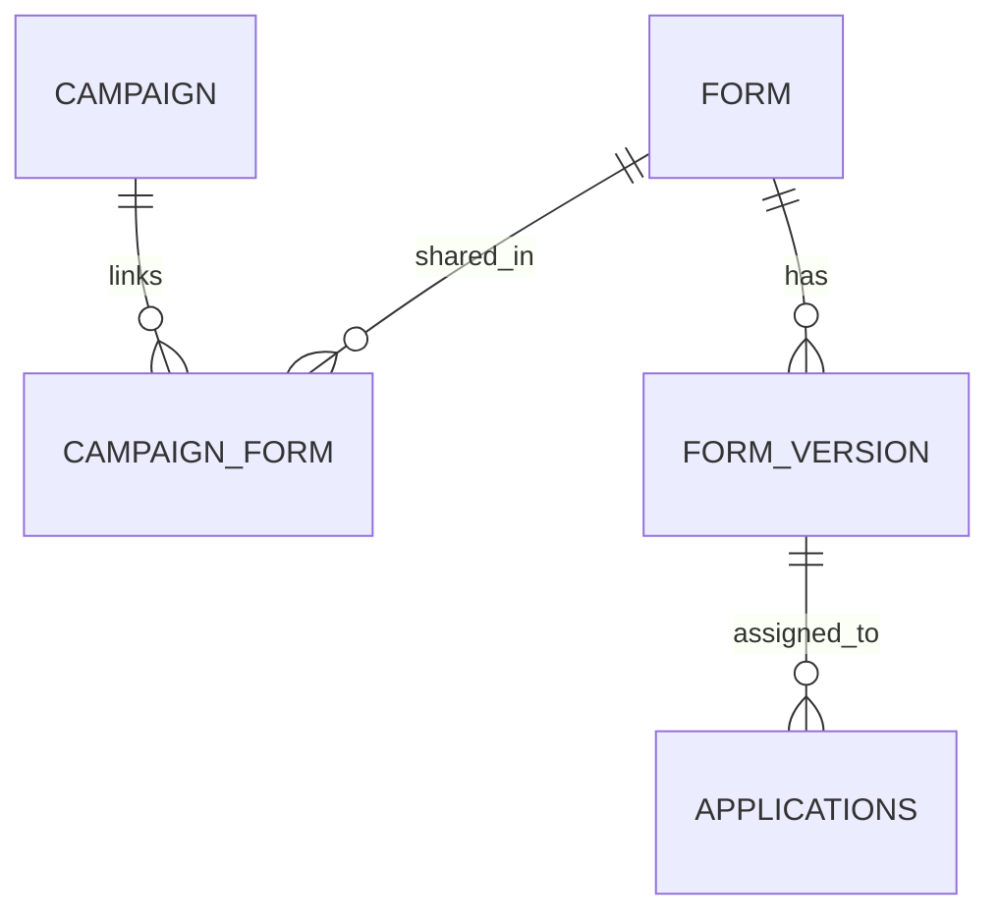

# Note - Evolution du rattachement partage entre Campaign et Form

**Date :** 2026-05-25
**Statut :** Cible d'architecture retenue, refonte non implementee
**Perimetre :** campaign, form, campaign_form, form_version, source_token, affectation candidat, back-office campagnes/formulaires

## 1. Decisions retenues

- [x] `form.campaign_id` doit sortir du modele cible.
- [x] Le rattachement entre campagnes et formulaires doit passer par une entite de liaison explicite `campaign_form`, et non par un `ManyToMany` implicite.
- [x] Un meme `Form` peut etre lie a plusieurs `Campaign`.
- [x] `FormVersion` reste rattache a `Form`, pas a `Campaign`.
- [x] Une seule `FormVersion` publiee active reste autorisee par `Form`.
- [x] Toutes les campagnes liees a un meme `Form` utilisent cette version publiee pour les futures candidatures.
- [x] `Applications.formVersion` reste l'ancre historique et continue de proteger l'historique candidat.
- [x] La duplication de formulaire est conservee comme action explicite pour creer une branche independante quand une campagne doit diverger du formulaire partage.
- [x] Les metadonnees propres a la relation campagne-formulaire doivent vivre sur `campaign_form`, pas sur `form`.
- [x] `campaign.timeAllForms` reste un parametre de campagne; `form.isTimed` reste un attribut global du formulaire partage.
- [x] Si une campagne doit diverger sur `isTimed`, sur la publication ou sur le contenu du formulaire, elle doit dupliquer explicitement le `Form` au lieu de modifier la ressource partagee.
- [x] `source_token` peut continuer a porter `form_id` dans un premier temps, a condition de verifier l'existence du lien (`campaign_id`, `form_id`) via `campaign_form`.

## 2. Probleme cible

Le modele actuel force un `Form` a appartenir a une seule `Campaign` via `form.campaign_id`.

Ce choix cree un couplage artificiel :

- pour reutiliser un formulaire dans deux campagnes, il faut aujourd'hui dupliquer le `Form` ;
- ensuite, toute evolution du formulaire partage doit etre rejouee manuellement sur chaque copie ;
- cette duplication repond a un besoin de divergence, mais pas au besoin de mutualisation.

Le besoin produit cible est au contraire :

- rattacher un meme formulaire logique a plusieurs campagnes ;
- modifier ce formulaire une seule fois ;
- publier une nouvelle version qui s'applique ensuite a toutes les campagnes liees pour les futures candidatures ;
- ne dupliquer le formulaire que quand l'utilisateur veut volontairement creer une variante independante.

## 3. Modele cible

### 3.1 Table `campaign_form`

Table de liaison explicite recommandee :

- `id`
- `campaign_id`
- `form_id`
- `assignment_order` ou equivalent si l'ordre des formulaires dans une campagne doit etre stable pour `SEQUENTIAL`
- `created_at`, `created_by`, `updated_at`, `updated_by`
- `is_deleted`
- `search_string`

Contraintes recommandees :

- cle etrangere `campaign_id -> campaigns.id`
- cle etrangere `form_id -> form.id`
- unicite active sur (`campaign_id`, `form_id`)
- index de lecture sur `campaign_id`
- index de lecture sur `form_id`
- index sur (`campaign_id`, `assignment_order`) si `assignment_order` est retenu

### 3.2 Entites conservees

- `Form` reste le support logique partage du questionnaire.
- `FormVersion` reste la version publiee/brouillon du contenu du formulaire.
- `Applications.formVersion` reste la reference historique utilisee au moment de l'affectation.

### 3.3 Publication retenue

La publication reste globale au niveau du `Form` :

- un seul brouillon/jeu de versions par `Form`
- au plus une `FormVersion` publiee active par `Form`
- toutes les campagnes liees consomment cette version publiee pour les futures candidatures

Ce choix repond bien au besoin "je modifie une fois, toutes les campagnes liees profitent de la nouvelle version".

## 4. Regles metier structurantes

### 4.1 Attacher un formulaire existant a une campagne

Le rattachement d'un `Form` existant a une nouvelle `Campaign` devient une simple creation de ligne `campaign_form`.

Effet attendu :

- aucune duplication automatique du `Form`
- la campagne partage le meme cycle de publication que les autres campagnes liees a ce `Form`

### 4.2 Modifier un formulaire partage

Quand un admin modifie un `Form` partage :

- il continue a travailler sur les `FormVersion` de ce `Form`
- la publication d'une nouvelle version bascule les futures candidatures de toutes les campagnes liees
- les candidatures deja creees restent rattachees a leur `formVersion` historique

### 4.3 Dupliquer un formulaire

La duplication reste necessaire, mais devient un choix explicite :

- pour creer une variante metier durable
- pour isoler une campagne qui ne doit plus suivre les futures publications du formulaire partage
- pour faire diverger le contenu, le timing ou la gouvernance de publication

### 4.4 Affectation candidat et strategies de campagne

Les strategies d'affectation (`RANDOM`, `RANDOM_NO_REPEAT`, `SOURCE_TOKEN`, `SEQUENTIAL`) doivent travailler sur la liste des formulaires lies a la campagne via `campaign_form`.

Implication importante :

- si `SEQUENTIAL` depend d'un ordre stable, cet ordre doit vivre sur `campaign_form.assignment_order`, pas sur `form`

### 4.5 Source token

Pour le premier refacto, `source_token` peut conserver `form_id` si le serveur valide que :

- le token appartient bien a la `Campaign`
- le `Form` reference est bien lie a cette `Campaign` via `campaign_form`

Si la liaison campagne-formulaire porte plus tard davantage de metadonnees fonctionnelles, une evolution vers `source_token.campaign_form_id` pourra etre envisagee.

### 4.6 `isTimed` et autres metadonnees de `Form`

Dans cette cible :

- `formName`, `formDesc`, `isActive` et `isTimed` sont compris comme des attributs globaux du formulaire partage
- `campaign.timeAllForms` reste un override de campagne deja snapshotte a l'affectation

Consequence :

- modifier `form.isTimed` impacte toutes les campagnes liees pour les futures candidatures
- si une seule campagne doit diverger, il faut dupliquer explicitement le `Form`

## 5. Checklist base de donnees

- [ ] Creer la table `campaign_form` avec soft-delete et champs techniques standards.
- [ ] Backfiller `campaign_form` depuis `form.campaign_id` pour toutes les lignes existantes non supprimees.
- [ ] Ajouter l'unicite active sur (`campaign_id`, `form_id`).
- [ ] Ajouter `assignment_order` sur `campaign_form` si la strategie `SEQUENTIAL` doit garder un ordre explicite des formulaires par campagne.
- [ ] Supprimer la dependance fonctionnelle a `form.campaign_id` dans le code applicatif.
- [ ] Supprimer ensuite la colonne `campaign_id` de `form` quand tous les usages auront migre.

## 6. Checklist backend

- [ ] Introduire une entite/repository/business explicites pour `campaign_form`.
- [ ] Migrer les recherches de formulaires par campagne vers `campaign_form`.
- [ ] Refaire la validation `source_token -> campaign -> form` via la table de liaison.
- [ ] Refaire `ApplicationsBusiness` pour selectionner les formulaires lies a la campagne via `campaign_form`.
- [ ] Supprimer les garde-fous temporaires de `FormBusiness` lies a la mutation directe de `campaignId`.
- [ ] Replacer l'attache/detache formulaire <-> campagne dans une couche metier dediee a la liaison.
- [ ] Ajouter un avertissement metier lors de la publication d'un formulaire partage indiquant combien de campagnes seront impactees.

## 7. Checklist frontend et back-office

- [ ] Retirer `campaignId` des formulaires admin si ce champ n'existe plus sur `Form`.
- [ ] Faire du back-office campagne le point principal d'attache/detache d'un formulaire partage.
- [ ] Afficher sur la fiche d'un formulaire la liste ou au moins le nombre de campagnes liees.
- [ ] Conserver une action explicite "Dupliquer le formulaire" depuis la fiche formulaire ou campagne.
- [ ] Si `SEQUENTIAL` doit etre pilotable en UI, exposer l'ordre des formulaires sur la liaison `campaign_form`.
- [ ] Ajouter une UX claire pour expliquer qu'une publication de formulaire partage impactera toutes les campagnes liees.

## 8. Strategie de migration recommandee

- [ ] 1. Introduire `campaign_form` et backfiller depuis `form.campaign_id`.
- [ ] 2. Migrer les lectures backend pour s'appuyer sur `campaign_form` sans encore supprimer `form.campaign_id`.
- [ ] 3. Migrer les ecrans back-office campagnes/formulaires vers la nouvelle liaison.
- [ ] 4. Migrer les validations `source_token` et l'affectation candidat.
- [ ] 5. Retirer les usages residuels de `form.campaign_id`.
- [ ] 6. Supprimer la colonne `form.campaign_id` et les garde-fous transitoires associes.

## 9. Risques et limites assumees

- [x] Cette cible ne permet pas de publier une version differente du meme `Form` par campagne.
- [x] Si ce besoin apparait plus tard, il faudra evoluer vers une publication par couple (`campaign_form`, `form_version`) ou un modele voisin.
- [x] `form.isTimed` reste partage entre campagnes; la divergence sur ce point passe par la duplication du formulaire.
- [x] La liaison explicite est volontairement preferable a un `ManyToMany` implicite, car elle permet de porter de vraies metadonnees de relation (`assignment_order`, futur statut, traces techniques, etc.).

## 10. Conclusion

La direction cible retenue est donc :

- rendre `Form` partageable entre plusieurs campagnes ;
- porter ce partage par une table de liaison explicite `campaign_form` ;
- conserver `FormVersion` comme version globale du formulaire ;
- conserver une seule version publiee active par `Form` ;
- utiliser la duplication de formulaire comme mecanisme volontaire de divergence, et non comme outil par defaut de reutilisation cross-campaign.

Cette architecture est mieux alignee avec le besoin produit "modifier une seule fois un formulaire partage", tout en gardant la possibilite de brancher le formulaire quand une campagne doit suivre une trajectoire independante.